# Design Patterns — C++ & Java

Implementations and practical examples of GoF (Gang of Four) design patterns in **C++ and Java**.

The goal of this repository is to understand the purpose, structure, and practical application of each pattern, including when it should and should not be used.

## Table of Contents

- [Creational Patterns](#creational-patterns)
- [Structural Patterns](#structural-patterns)
- [Behavioral Patterns](#behavioral-patterns)

---

# Creational Patterns

Creational patterns deal with **how objects are created**, helping reduce coupling between object creation and object usage.

## 1. Singleton

**Purpose:** Ensure that a class has only one instance and provide a global access point to it.

**Main participants:**
- `Singleton` — controls instance creation and provides access to the instance.

**When to use it:**
- Do multiple parts of the application need to access the same shared instance?
- Must the class guarantee that only one instance exists?

**Example:** Application-wide configuration or a shared logging service.

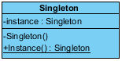

## 2. Factory Method

**Purpose:** Define an interface for creating an object while allowing subclasses to decide which concrete type to instantiate.

**Main participants:**
- `Product` — interface of the created objects.
- `ConcreteProduct` — specific product implementations.
- `Creator` — declares the factory method and may use the created product.
- `ConcreteCreator` — implements the factory method.

**When to use it:**
- Does the code need to create different implementations of the same interface?
- Should subclasses decide which concrete product gets created?
- Do you want the client to depend on a product interface rather than concrete classes?

**Example:** Different notification creators producing email or SMS notifications.

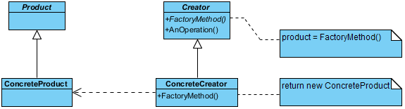

## 3. Abstract Factory

**Purpose:** Create families of related objects without specifying their concrete classes.

**Main participants:**
- `AbstractFactory` — declares creation methods for related products.
- `ConcreteFactory` — creates a compatible family of products.
- `AbstractProduct` — interface for each product type.
- `ConcreteProduct` — concrete implementations of the products.

**When to use it:**
- Do you need to create several related objects that must work together?
- Should the application switch between entire product families?
- Do you want to avoid mixing incompatible products from different families?

**Example:** Windows and macOS factories producing matching buttons and checkboxes.

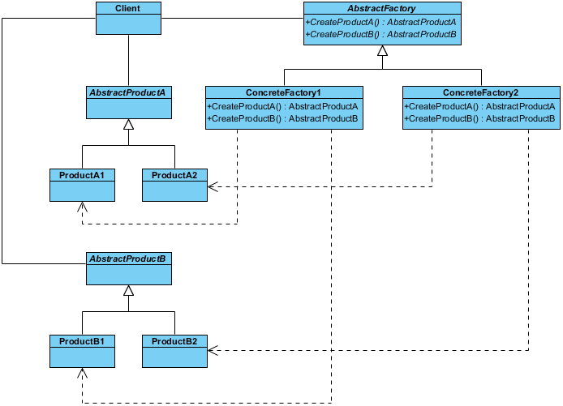

## 4. Builder

**Purpose:** Construct complex objects step by step, separating construction from the final object representation.

**Main participants:**
- `Builder` — defines construction operations.
- `ConcreteBuilder` — implements the construction process.
- `Product` — the object being built.
- `Director` *(optional)* — defines a particular construction sequence.

**When to use it:**
- Does an object have many optional parameters or configuration steps?
- Are constructors becoming long or difficult to read?
- Do you need validation or different ways to construct the same kind of object?

**Example:** Building a configured character with a name, weapon, armor, health, and speed.

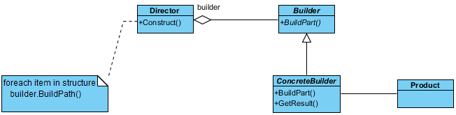

## 5. Prototype

**Purpose:** Create new objects by copying existing instances instead of constructing them from scratch.

**Main participants:**
- `Prototype` — declares a cloning operation.
- `ConcretePrototype` — implements cloning for a specific object type.
- `Client` — obtains new objects by cloning prototypes.

**When to use it:**
- Is creating or configuring a new object expensive or repetitive?
- Do you frequently need new objects based on existing configurations?
- Can the object's copy semantics be clearly defined?

**Example:** Creating game enemies from configured templates while giving each clone its own position and runtime state.

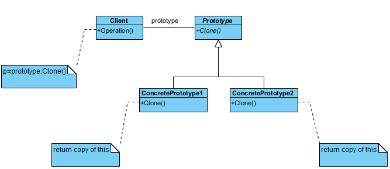

---

# Structural Patterns

Structural patterns deal with **how classes and objects are composed** to form larger, flexible structures.

## 1. Adapter

**Purpose:** Make incompatible interfaces work together without changing the existing classes.

**Main participants:**
- `Target` — interface expected by the client.
- `Adaptee` — existing class with an incompatible interface.
- `Adapter` — translates calls between the target and the adaptee.
- `Client` — uses the target interface.

**When to use it:**
- Does an existing class provide the functionality you need but expose the wrong interface?
- Do you need to integrate a legacy system or external library without changing its API?

**Example:** Adapting a Fahrenheit sensor to an interface that returns Celsius.

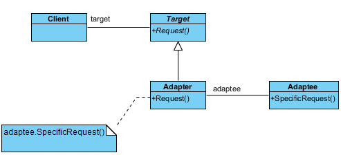

## 2. Bridge

**Purpose:** Separate an abstraction from its implementation so both can evolve independently.

**Main participants:**
- `Abstraction` — defines high-level operations and holds a reference to an implementation.
- `RefinedAbstraction` — extends the abstraction.
- `Implementor` — declares implementation operations.
- `ConcreteImplementor` — provides platform- or implementation-specific behavior.

**When to use it:**
- Are there two independent dimensions of variation?
- Would inheritance create a large number of classes for every combination?
- Do you want to change the abstraction and implementation independently?

**Example:** Different remote controls working with different device types.

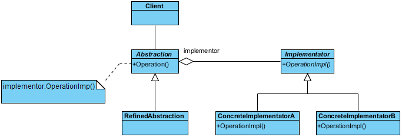

## 3. Composite

**Purpose:** Treat individual objects and compositions of objects uniformly through a common interface.

**Main participants:**
- `Component` — common interface for individual objects and groups.
- `Leaf` — individual object with no children.
- `Composite` — contains child components and delegates operations to them.
- `Client` — uses the common interface.

**When to use it:**
- Do you need to represent a tree-like hierarchy?
- Should the client perform the same operation on an individual object or an entire group?
- Can a group contain both individual objects and other groups?

**Example:** Files and folders, where a folder can calculate the total size of its contents.

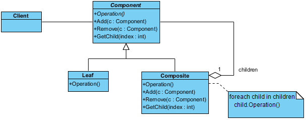

## 4. Decorator

**Purpose:** Add responsibilities to an object dynamically without modifying its class or creating a subclass for every combination of features.

**Main participants:**
- `Component` — common interface.
- `ConcreteComponent` — original object.
- `Decorator` — implements the same interface and wraps another component.
- `ConcreteDecorator` — adds specific behavior.

**When to use it:**
- Do you need to add optional features to individual objects?
- Would subclassing produce too many combinations of features?
- Should multiple enhancements be combined in different orders?

**Example:** Adding milk and caramel to a coffee object while preserving the same beverage interface.

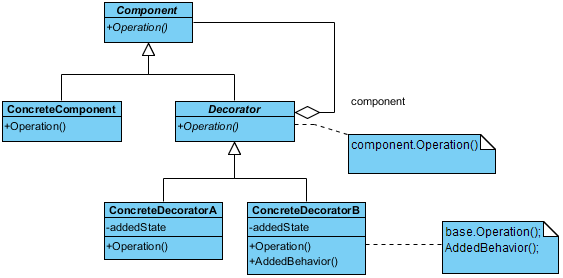

## 5. Facade

**Purpose:** Provide a simple interface to a complex subsystem.

**Main participants:**
- `Facade` — provides high-level operations and coordinates subsystem classes.
- `Subsystem classes` — perform the actual underlying work.
- `Client` — uses the simplified interface.

**When to use it:**
- Does the client need to coordinate many classes or operations to perform one task?
- Is a subsystem unnecessarily complicated to use?
- Would a higher-level interface reduce dependencies on implementation details?

**Example:** A home theater facade that turns on the TV, configures the sound system, and starts a movie.

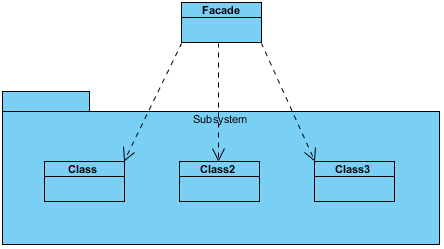

## 6. Proxy

**Purpose:** Control access to another object through a substitute that exposes the same interface.

**Main participants:**
- `Subject` — common interface for the proxy and real object.
- `RealSubject` — performs the actual work.
- `Proxy` — controls access to the real subject and may forward calls to it.
- `Client` — uses the subject interface.

**When to use it:**
- Should an expensive object be created only when needed?
- Must access be checked before reaching the real object?
- Do you need remote access or caching without changing the client's interface?

**Example:** An image proxy that loads a large image only when it is first displayed.

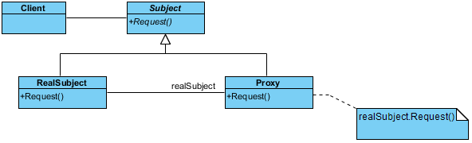

## 7. Flyweight

**Purpose:** Reduce memory usage by sharing common state among many similar objects.

**Main participants:**
- `Flyweight` — defines the shared-state interface.
- `ConcreteFlyweight` — stores intrinsic, shareable state.
- `FlyweightFactory` — reuses existing flyweight objects.
- `Client` — supplies or maintains extrinsic, object-specific state.

**When to use it:**
- Are there very many similar objects?
- Do they duplicate large amounts of identical data?
- Can common state be separated from state unique to each object?

**Example:** Thousands of bullets sharing texture and base damage while maintaining independent positions and velocities.

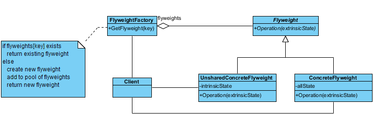

---

# Behavioral Patterns

Behavioral patterns deal with **how objects communicate, distribute responsibilities, and coordinate behavior**.

## 1. Strategy

**Purpose:** Encapsulate interchangeable algorithms behind a common interface so the algorithm can be selected or replaced independently of the client.

**Main participants:**
- `Strategy` — common algorithm interface.
- `ConcreteStrategy` — specific algorithm implementations.
- `Context` — delegates work to a strategy.
- `Client` — selects and supplies the strategy.

**When to use it:**
- Are there multiple ways to perform the same task?
- Do you want to switch algorithms at runtime?
- Are conditional statements selecting among interchangeable algorithms becoming difficult to maintain?

**Example:** Switching between driving, walking, and cycling route algorithms.

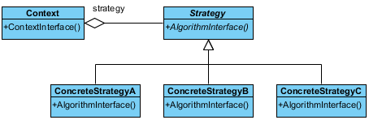

## 2. Command

**Purpose:** Encapsulate a request as an object, allowing requests to be stored, queued, passed around, or undone.

**Main participants:**
- `Command` — declares an execution operation.
- `ConcreteCommand` — implements the request by invoking a receiver.
- `Receiver` — performs the actual work.
- `Invoker` — triggers the command.
- `Client` — creates and connects the objects.

**When to use it:**
- Should requests be queued, logged, or executed later?
- Do you need undo/redo functionality?
- Should the component initiating an action be independent of the object performing it?

**Example:** A remote control executing commands that turn a light on or off.

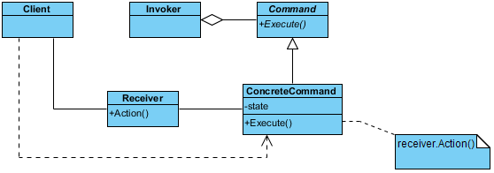

## 3. Mediator

**Purpose:** Centralize communication and coordination between objects so they do not need direct references to one another.

**Main participants:**
- `Mediator` — declares the coordination interface.
- `ConcreteMediator` — implements communication rules.
- `Colleagues` — components that communicate through the mediator.
- `Client` — creates and connects the components.

**When to use it:**
- Do many objects communicate directly with one another?
- Are their dependencies becoming difficult to manage?
- Would centralizing interaction rules simplify the system?

**Example:** A chat room mediating messages between users.

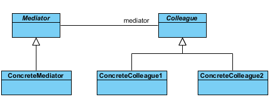

## 4. Memento

**Purpose:** Capture and restore an object's previous state without exposing its internal representation.

**Main participants:**
- `Originator` — owns the state and creates/restores snapshots.
- `Memento` — stores a snapshot of the state.
- `Caretaker` — stores and manages snapshots without modifying their contents.

**When to use it:**
- Do you need undo, rollback, or state restoration?
- Must the object's internal state remain encapsulated?
- Do you need to keep snapshots without exposing the object's internals?

**Example:** An editor saving previous document states to support undo.

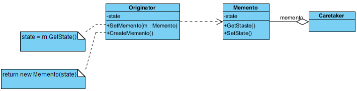

## 5. Observer

**Purpose:** Establish a one-to-many dependency so that when a subject changes state, its observers are notified.

**Main participants:**
- `Subject` — maintains observers and notifies them.
- `Observer` — defines the notification interface.
- `ConcreteObserver` — reacts to notifications.
- `Client` — connects subjects and observers.

**When to use it:**
- Should multiple components react to changes in one object?
- Do you want to avoid tightly coupling the subject to specific consumers?
- Can subscribers be added or removed dynamically?

**Example:** A weather station notifying multiple displays when the temperature changes.

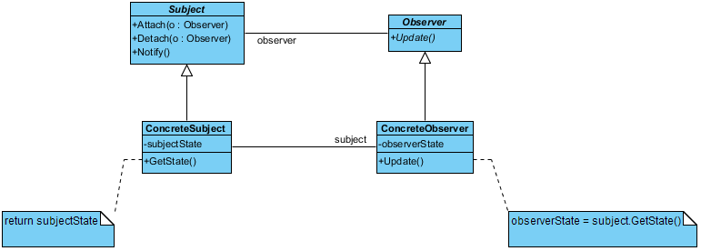

## 6. Template Method

**Purpose:** Define the skeleton of an algorithm in a base class while allowing subclasses to implement or customize selected steps.

**Main participants:**
- `AbstractClass` — defines the template method and common steps.
- `ConcreteClass` — implements or overrides variable steps.
- `Client` — uses the algorithm through the base abstraction.

**When to use it:**
- Do several classes follow the same overall sequence of steps?
- Are only some steps different between implementations?
- Do you want to reuse common logic while enforcing a consistent algorithm structure?

**Example:** Preparing coffee and tea using the same sequence: boil water, brew, pour, and add optional ingredients.

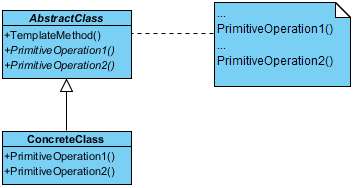

---

## Quick Comparison

| If you need to... | Consider... |
|---|---|
| Control the number of instances | Singleton |
| Let subclasses decide which product to create | Factory Method |
| Create compatible families of objects | Abstract Factory |
| Build a complex object step by step | Builder |
| Create objects by copying existing instances | Prototype |
| Adapt an incompatible interface | Adapter |
| Separate two independent dimensions of variation | Bridge |
| Treat individual objects and groups uniformly | Composite |
| Add behavior dynamically | Decorator |
| Simplify access to a complex subsystem | Facade |
| Control access to an object | Proxy |
| Share common state among many objects | Flyweight |
| Switch between interchangeable algorithms | Strategy |
| Represent requests as objects | Command |
| Centralize communication between components | Mediator |
| Save and restore object state | Memento |
| Notify subscribers about state changes | Observer |
| Reuse an algorithm skeleton with variable steps | Template Method |

## Repository Structure

```text
design-patterns/
├── README.md
├── creational/
│   ├── singleton/
│   ├── factory-method/
│   ├── abstract-factory/
│   ├── builder/
│   └── prototype/
├── structural/
│   ├── adapter/
│   ├── bridge/
│   ├── composite/
│   ├── decorator/
│   ├── facade/
│   ├── proxy/
│   └── flyweight/
└── behavioral/
    ├── strategy/
    ├── command/
    ├── mediator/
    ├── memento/
    ├── observer/
    └── template-method/
```

Each pattern is implemented in both C++ and Java, with examples kept simple and focused on the core idea of the pattern.

**Note:** Design patterns are tools, not rules. Use a pattern when it solves a real design problem, not merely because it exists.
